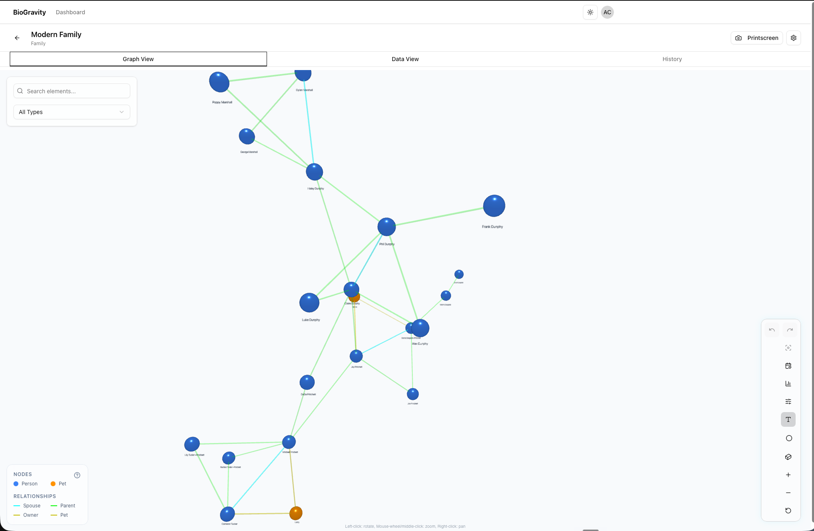

# BioGravity

**An interactive 3D relationship-mapping workspace — and the pet project I built it to learn from.**

Build, navigate and share force-directed graphs of *elements* (people, organisations, anything) and *relationships* between them. Open a project in an immersive 3D scene (Three.js + `react-force-graph-3d`), flatten it to 2D, tune the physics live, isolate by focus and degrees of separation, edit the underlying data in a spreadsheet-style view, and share read-only links — solo or with collaborators.



---

## About this project

BioGravity is a personal project. I built it to learn a stack I hadn't worked with end-to-end before, and to ship something that *felt* complete rather than something marketable. It is not a product, has no commercial intent, and is published here primarily as a portfolio piece.

What I set out to learn:

- **Next.js 16 App Router** with React 19 server components, Route Handlers, and the new caching model.
- **Three.js / React Three Fiber** for real 3D — not "a chart in 3D," but a force-directed scene you can orbit, pin, search, and isolate.
- **Prisma + PostgreSQL** as a typed data layer, with migrations that survive a Docker rebuild on someone else's machine.
- **Zustand with sliced state** (graph / ui / history) and Immer drafts, because Redux was overkill and `useState` wasn't enough.
- **Docker + GHCR + Cloudflare Tunnel + Watchtower** on a Synology NAS — taking the project from "runs on my laptop" to "auto-deploys from `main` to a box in my office" without leasing a VPS.
- **Resend + React Email** for transactional invitations that actually arrive.

The interesting bits — the things that took the most fighting — are documented in [`walkthroughs/`](walkthroughs/README.md). If you want to see how the project really came together (the WebGL crash from a too-new Three.js, the Prisma binary-target wrangle on ARM, the deploy-to-NAS saga), that folder is the honest version.

The product description, role catalogue, epic taxonomy, and explicit out-of-scope register live in [`docs/product/`](docs/product/). They're written more carefully than this README — I wanted the practice of producing PM-grade artefacts alongside the code.

> **Status:** feature-complete for the goals I set, but explicitly *not* a product. Items in [`docs/product/05-out-of-scope.md`](docs/product/05-out-of-scope.md) (Story Mode, custom attribute schemas, GEDCOM export, undo/redo UI, etc.) are deferred and unlikely to be picked up.

---

## What it does

### Visualise

- **3D & 2D modes** — switch between an immersive Three.js scene and a flat 2D force-graph view.
- **Live-tunable physics** — cluster attraction, link strength, repulsion, link distance, and a generational-layout strength, all editable per-project from a drawer.
- **Insights panel** — totals, average degree, density, most-connected nodes, type distribution, and selected-node degree.
- **Focus mode** — isolate a node and expand by 1, 2, or 3 degrees of separation.
- **Pin & save** node positions to exact 3D coordinates; layouts survive refresh.
- **Search, filter, isolate-by-attribute** — fade non-matches rather than just highlighting hits.
- **High-resolution PNG export** of the graph and its legend.

### Edit

- **Spreadsheet-style Data view** — every element and relationship in a structured table; inline editing, batch operations.
- **In-graph editing** — add, edit, delete elements and relationships directly from the canvas.
- **Optimistic updates with rollback** — failed update / delete / pin requests roll back and surface an error toast (no stale ghost edits).
- **Per-element images** with crop on upload.

### Configure

- **Project schemas** — define element and relationship types per project (name + colour); the legend stays in sync automatically.
- **Two default schemas** ship in the box:
  - **Family** — Person, Pet · parent/child, partner, owner/pet.
  - **Organization** — Person, Company, Department, Team · direct/indirect report.
- **Seed data** — one click loads a working demo (Modern Family for Family projects, an org chart for Organization).
- **Visibility toggle** — Private (invite-only) or Public (link-bearer access in read-only Viewer mode).

### Collaborate

- **Per-project roles** — Owner, Admin, Editor, Viewer.
- **Email invitations via Resend** — React Email + plain-text fallback; pending invites surface their delivery state and offer a re-send button.
- **Invite-by-email without an account** — recipients get a 7-day single-use link that registers/signs them in and joins them to the project at the intended role.
- **Copy-link fallback** when Resend isn't configured or the call fails.

### Share

- **Public share token** — flip visibility to Public, copy the `/public/<token>` link, and anyone with the link gets read-only access.

### Trust

- **Change log** with full audit trail (prior + new state) on every element/relationship change.
- **History tab** in the Data section lists recent changes with timestamps and the user who made them.
- **Authentication** via NextAuth.js (credentials + Prisma adapter, JWT sessions).

---

## Tech stack

| Layer | Choice | Why this, on this project |
|---|---|---|
| Framework | Next.js 16 (App Router) | I wanted hands-on time with the new caching model and Route Handlers. |
| UI | React 19, Tailwind, shadcn/ui, Radix, Lucide | Pre-built accessible primitives so the time went into the graph, not buttons. |
| 3D engine | Three.js, R3F, `react-force-graph-3d`, `d3-force-3d` | Real 3D force layout, not a styled chart. |
| State | Zustand (sliced) + Immer | Three independent concerns (graph, UI, history) without Redux ceremony. |
| Backend | Next.js Route Handlers in `src/app/api/` | Co-locate API and UI; one deploy artefact. |
| Auth | NextAuth.js (Credentials + Prisma adapter, JWT) | Self-hosted-friendly; no third-party identity dependency. |
| Database | PostgreSQL via Prisma | Typed access end-to-end, migrations under version control. |
| Email | Resend (EU) + React Email | Transactional invites with a real fallback story. |
| Validation | Zod | Single schema source on the wire and at the boundary. |
| Tests | Vitest + Testing Library + jsdom | Faster cold-start than Jest, plays well with Vite tooling. |
| Infra | Docker Compose locally; GHCR images + Cloudflare Tunnel + Watchtower in production | Auto-deploy `main` to a Synology NAS with no public ingress. |

---

## Running it

There are three supported modes, all Docker-based.

| Mode | For | What you get |
|---|---|---|
| **Self-hosted (personal)** | One user, one machine — try it locally. | Local Docker stack on `http://localhost:3020` with bundled Postgres. |
| **Group / SaaS deployment** | A small group sharing one instance over the internet. | GHCR-built image behind Cloudflare Tunnel (or any reverse proxy) with persistent Postgres and optional auto-update. |
| **Demo instance** | Screenshots, screencasts, letting someone click around. | Disposable stack on `http://localhost:3030`, pre-loaded with two populated projects and a known login. |

### Prerequisites

- Docker and Docker Compose.
- Node.js 20.9+ only if you want to run the dev server outside Docker.
- A Resend account + verified domain — optional; the copy-link fallback works without it.

### 1. Self-hosted — local single-user

```bash
git clone https://github.com/authrain-cloud-abdullahformuli/BioGravity.git
cd BioGravity
cp .env.example .env
# Open .env and fill NEXTAUTH_SECRET (any 32+ char random string).
# Leave RESEND_API_KEY blank — invites will fall back to copy-link.

docker compose up --build
```

Open <http://localhost:3020>. Sign up, create a project, pick *Family* or *Organization*, click *Seed* to load demo data, and start exploring.

Generate a strong `NEXTAUTH_SECRET`:

```bash
openssl rand -base64 48
```

**Where your data lives:** in the `postgres_data` Docker volume on your machine. To wipe everything and start fresh: `docker compose down -v`.

### 2. Demo instance

A disposable instance pre-loaded with sample data — no sign-up, no empty first screen, no hunting for something to click. [`docker-compose.demo.yml`](docker-compose.demo.yml) is standalone rather than an overlay, so it needs no local build and runs anywhere the published image can be pulled.

```bash
cp .env.demo.example .env.demo
# Fill NEXTAUTH_SECRET. The rest works as-is.

docker compose -f docker-compose.demo.yml --env-file .env.demo up -d
docker compose -f docker-compose.demo.yml --env-file .env.demo run --rm seed
```

Open <http://localhost:3030>. The seeder creates two accounts:

| Account | Role | Use it for |
|---|---|---|
| `demo@example.com` / `biogravity-demo` | **Viewer** on both projects | The login you hand out. Read-only — safe to share. |
| `curator@example.com` / `biogravity-curator` | **Owner** of both projects | Recording edit flows. Keep this one private. |

You get two projects, each with a colour-coded legend:

| Project | Shape | Good for showing |
|---|---|---|
| **Modern Family** | 21 elements, 38 relationships — dense and cyclic | Focus mode, degrees of separation, the public share link (it ships Public) |
| **Acme Corporation** | 12 elements, 11 relationships — mostly a tree | Generational layout, hierarchy, the Data view |

#### Sharing the demo with everyone

The demo account is safe to advertise. It owns nothing — the curator account does — and because owners are auto-promoted to Admin, keeping `demo@example.com` a plain Viewer is exactly what makes every project write return `403`.

Two actions sit *outside* the project role model and would still let one visitor spoil it for the rest: editing the account's own profile (which can change the login email and lock everybody out) and creating projects, which makes the creator their Admin. Setting `DEMO_READONLY_EMAIL` to the shared address blocks both, in the API and in the UI:

```env
DEMO_READONLY_EMAIL=demo@example.com
```

Leave it unset on a normal deployment and it is a no-op — see [`src/lib/demo-mode.ts`](src/lib/demo-mode.ts).

Signed in as the demo account a visitor can still read both projects, open the graph and Data views, use focus mode, filters, physics and export, and read the change log. Sign-up stays open, so anyone who wants to actually build something can make their own account.

**Resetting between takes** — re-run the `seed` line. It drops both accounts' projects and rebuilds them, so every recording starts from an identical state:

```bash
docker compose -f docker-compose.demo.yml --env-file .env.demo run --rm seed
```

To tear the whole thing down including its database: `docker compose -f docker-compose.demo.yml --env-file .env.demo down -v`.

**Isolation** — container names, network, named volume and host port are all `demo`-scoped, and the containers are labelled so Watchtower leaves them alone. A demo stack can run alongside a real deployment without touching its data.

> Both logins are known in advance by design. `RESEND_API_KEY` is deliberately unset so a demo instance can never email a real address. Change `DEMO_OWNER_PASSWORD` before exposing the instance beyond your LAN — the curator account can edit everything.

The seeder ([`prisma/seed.mjs`](prisma/seed.mjs)) also runs directly against any database if you'd rather not use the demo stack:

```bash
DATABASE_URL=postgresql://... npm run db:seed
```

### 3. Group / SaaS deployment

Run a shared instance for a team or family group. The reference deployment targets a Synology DS723+ behind a Cloudflare Tunnel; the same overlay works on any Linux host that can run Docker.

```
Users ──HTTPS──▶ Cloudflare (TLS terminated at the edge)
                      │
                      ▼
                Cloudflare Tunnel
                      │
                      ▼
         Host:APP_PORT (loopback only)
                      │
                      ▼
            biogravity-app container ───▶ biogravity-postgres
                                          (bind-mounted volume)
                      ▲
                      │
                Watchtower (optional) ──▶ polls GHCR every 5 min
                                          and rolls forward
```

#### Step 1 — Prepare the host

- Install Docker + Docker Compose.
- Create a directory for the Postgres bind-mount (on Synology this is typically `/volume1/docker/biogravity/postgres-data`).
- Set up Cloudflare Tunnel (or your reverse proxy of choice) to terminate TLS and forward your public hostname to `http://<host>:APP_PORT`.

#### Step 2 — Configure environment

Copy [`.env.prod.example`](.env.prod.example) to `.env.prod` on the host and fill in:

```env
IMAGE_TAG=latest                                  # or pin to :sha-XXXXXXX / :vX.Y.Z
NEXTAUTH_URL=https://biogravity.example.com       # the public URL behind the tunnel
NEXTAUTH_SECRET=<openssl rand -base64 48>
RESEND_API_KEY=<your Resend key>                  # required for emailed invites
RESEND_FROM=BioGravity Invites <invites@mail.example.com>
POSTGRES_USER=biogravity
POSTGRES_PASSWORD=<openssl rand -hex 16>
POSTGRES_DB=biogravity
POSTGRES_DATA_DIR=/volume1/docker/biogravity/postgres-data
APP_PORT=3020                                     # loopback only — tunnel is the only ingress
```

> Never commit `.env.prod`. It's gitignored via `.env*`.

#### Step 3 — Pull and start

```bash
docker compose \
  -f docker-compose.yml \
  -f docker-compose.prod.yml \
  --env-file .env.prod \
  up -d
```

The prod overlay ([`docker-compose.prod.yml`](docker-compose.prod.yml)):

- Pulls the prebuilt image from `ghcr.io/authrain-cloud-abdullahformuli/biogravity-portfolio:${IMAGE_TAG}` — no build on the host.
- Bind-mounts Postgres data to `POSTGRES_DATA_DIR` so it survives container recreation and can be backed up by DSM (or your host's backup tool).
- Gates app startup on a Postgres healthcheck so you never hit a half-ready database.
- Restarts both services unless explicitly stopped.
- Runs a **Watchtower** sidecar (label-scoped to BioGravity images only) that polls GHCR every 5 minutes and rolls forward new releases automatically.

#### Step 4 — Verify

```bash
docker compose -f docker-compose.yml -f docker-compose.prod.yml ps
docker compose -f docker-compose.yml -f docker-compose.prod.yml logs -f app
```

Then open your public URL. Register the first user — they become the Owner of every project they create. Invite collaborators from inside any project.

#### Upgrades & rollback

- **Upgrade** — Watchtower handles `:latest` automatically. To upgrade manually: edit `IMAGE_TAG` in `.env.prod`, then `docker compose ... pull && docker compose ... up -d`.
- **Rollback** — pin `IMAGE_TAG=sha-<7-char-commit>` or `vX.Y.Z` in `.env.prod` and re-up. Image tags are published by the GitHub Actions workflow on every push to `main` and every `v*` tag.

#### CI/CD

The [GitHub Actions workflow](.github/workflows/build-and-push.yml) builds and pushes the image to `ghcr.io/authrain-cloud-abdullahformuli/biogravity-portfolio` on every push to `main` (`:latest` + `:sha-<7>`) and every `v*` tag (`:vX.Y.Z`). If you fork the repo, update the image name in `docker-compose.prod.yml` and `.env.prod.example` to point at your own GHCR namespace.

---

## Local development

For working on the code itself rather than running it as an app.

```bash
npm ci
cp .env.example .env
# Fill DATABASE_URL pointing at a local or Docker Postgres,
# NEXTAUTH_SECRET, and optionally RESEND_API_KEY.

# Start just the database from the compose stack:
docker compose up -d postgres

# Apply the schema:
npx prisma migrate dev

# Run the Next.js dev server:
npm run dev
```

The dev server runs on <http://localhost:3000> by default (the Docker stack maps to `3020` to avoid clashing).

### Useful scripts

| Command | What it does |
|---|---|
| `npm run dev` | Next.js dev server with webpack. |
| `npm run build` | Production build. |
| `npm start` | Serve the built app. |
| `npm run lint` | ESLint. |
| `npm test` | Vitest. |
| `npm run db:seed` | Load the demo account + sample projects into `DATABASE_URL`. Destructive: replaces the demo user's projects. |

---

## Environment variables

| Variable | Required | Purpose |
|---|---|---|
| `DATABASE_URL` | Yes | Postgres connection string. |
| `NEXTAUTH_URL` | Yes | Public URL used to sign session cookies and build invite links. |
| `NEXTAUTH_SECRET` | Yes | 32+ char random secret for NextAuth JWT signing. |
| `RESEND_API_KEY` | No | When set, invitations are sent as email. When unset, the UI surfaces a copyable link. |
| `RESEND_FROM` | No | `From` header for invite emails (must be a verified Resend sender). |
| `POSTGRES_USER` / `POSTGRES_PASSWORD` / `POSTGRES_DB` | Prod overlay only | Database credentials for the bundled Postgres container. |
| `POSTGRES_DATA_DIR` | Prod overlay only | Host path bind-mounted into Postgres for persistence. |
| `APP_PORT` | Prod overlay only | Host port the app binds to (default `3020`). |
| `IMAGE_TAG` | Prod / demo only | GHCR image tag to deploy (`latest`, `sha-<7>`, or `vX.Y.Z`). |
| `DEMO_APP_PORT` | Demo only | Host port for the demo app (default `3030`). |
| `DEMO_EMAIL` / `DEMO_PASSWORD` / `DEMO_NAME` | Demo only | Shared read-only account the seeder creates (Viewer on both projects). |
| `DEMO_OWNER_EMAIL` / `DEMO_OWNER_PASSWORD` / `DEMO_OWNER_NAME` | Demo only | Account that owns the seeded projects. Keep private. |
| `DEMO_READONLY_EMAIL` | No | Blocks profile edits and project creation for this one account. Unset = no-op. |

---

## Project structure

```
src/
  app/              # Next.js App Router (routes + API)
    api/            # Route Handlers (auth, projects, elements, invites, ...)
    dashboard/      # Project list
    projects/       # Per-project pages (graph, data, settings)
    public/         # Read-only token-bearer views
    invite/         # Invite acceptance flow
    login/ signup/ profile/
  components/       # UI: graph/, dashboard/, projects/, settings/, ui/, landing/
  lib/              # Server + shared utilities (prisma, auth, schemas, ...)
  store/            # Zustand slices (graph / ui / history)
  types/
prisma/             # schema.prisma + migrations
  demo/             # Sample datasets (shared by the Seed button and seed.mjs)
  seed.mjs          # Demo-instance seeder
features/           # Original product spec, implementation plan, gap analysis
docs/
  product/          # Role catalog, epic taxonomy, product description, out-of-scope
  features/         # Per-feature changelogs
walkthroughs/       # Dev log — see walkthroughs/README.md
```

---

## Key views

- **Dashboard** — every project you own or are a member of.
- **Graph** — the 3D / 2D canvas. Default tab when you open a project.
- **Data** — spreadsheet view of every element and relationship + the History tab.
- **Project Settings** — schema, members, visibility, and danger zone.
- **Profile** — your account.

---

## License

[MIT](LICENSE). Use it, fork it, learn from it. No warranty.

---

*Visualise the gravity of your connections.*
