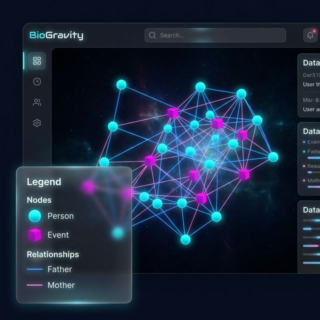

# Dynamic Graph Legend Implementation (2026-02-26)

I have updated the 3D graph view to dynamically reflect the node and relationship types configured in the project settings. This ensures the legend is always consistent with the user's project schema.

## Changes Made

- **Dynamic Legend**: The `GraphLegend` component now retrieves `elementTypes` and `relationshipTypes` from the global graph store instead of using hardcoded arrays.
- **Configurable Colors**: Updated the color rendering logic for both nodes and relationships. The system now searches for the specific type in the project configuration to find its assigned color.
- **Fallback Logic**: Maintained the existing hardcoded color logic as a fallback for projects using default types or legacy data.
- **UI Improvements**: The legend now supports scrolling for projects with many types and automatically hides sections if no types are configured.

## Verification

### Implementation Details

- **Store Integration**: Linked `graph-scene.tsx` with the `elementTypes` and `relationshipTypes` states in `useGraphStore`.
- **Component Update**: Refactored `GraphLegend` to map over dynamic arrays instead of hardcoded strings.
- **Color Sync**: Patched `nodeThreeObject` and `linkColor` props of the `ForceGraph3D` component to pass the configuration context down to the color mapping functions.

### Visual Mockup

The following image represents the expected behavior with custom configurations:

