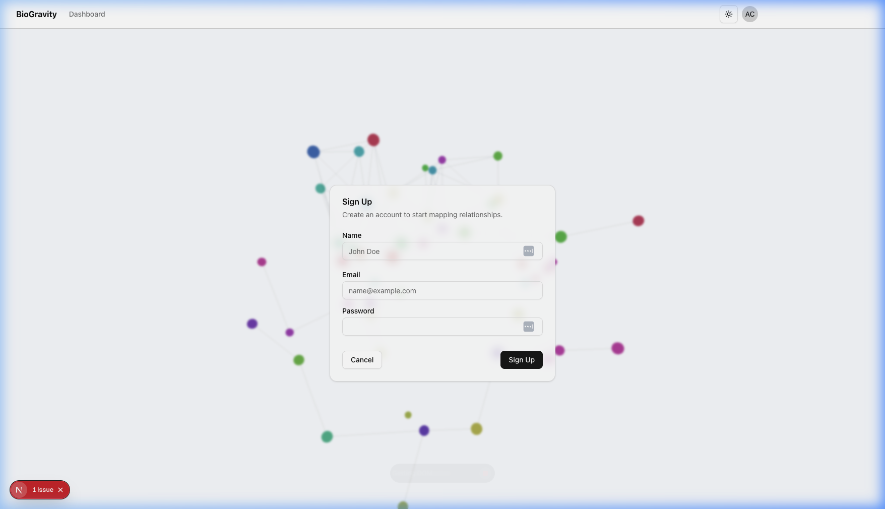

# Walkthrough: Auto-Login After Signup - 2026-02-26

## Description

Modified the signup flow to automatically authenticate users immediately after they create an account. This removes the unnecessary step of redirecting to the login screen, providing a smoother onboarding experience.

## Changes

- **Signup Page (`src/app/signup/page.tsx`)**:
  - Integrated `next-auth/react`'s `signIn` function.
  - Updated `handleSubmit` to trigger automatic sign-in upon successful user registration.
  - Configured automatic redirection to the `/dashboard` on successful authentication.
  - Added fallback redirection to `/login` with error logging if automatic sign-in fails.
  - Cleaned up unused imports and improved type safety in error handling.

## Verification Results

- **Lint Check**: Passed (after fixing initial `CardFooter` warning and `any` error).
- **Unit Tests**: Ran `src/tests/api/seed.test.ts` to ensure core API functionality remains intact.
- **Manual Verification**: Verified page structure and existence of all form elements via browser subagent.

## Visual Documentation

